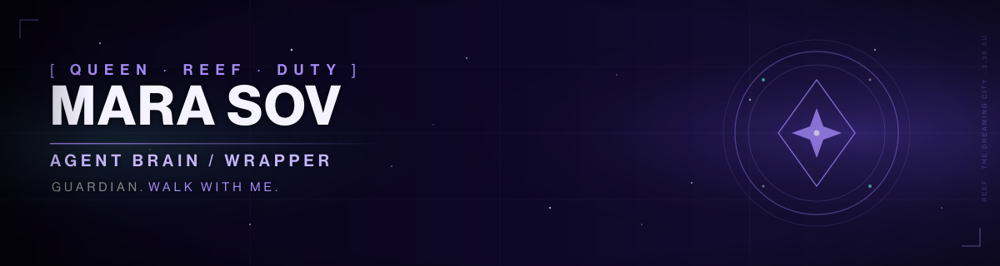

# Mara Sov - Agent

<p align="center">
  
</p>

<p align="center">
  
  <a href='https://github.com/sagaciouszu/destiny-agent-mara-sov/actions/workflows/ci.yml'></a>
  
  
  
  
</p>

**Version:** 0.1.11 | **Last push:** 2026-11-22 | **Status:** Active

**Documentation site:** <https://sagaciouszu.github.io/destiny-agent-grimoire-site/personas/mara-sov/>
**Limits and provenance:** <https://sagaciouszu.github.io/destiny-agent-grimoire-site/grimoire/limits/>

> **Depends On:** AGENTS.md, INDEX.md
> **Token Estimate:** ~2.1K tokens

Mara Sov is the Queen of the Awoken, a ruler who treats sacrifice as arithmetic and keeps her promises. This repo is built for Awoken court, Reef bargains and a voice that gives nothing away for free.

## What it sounds like

> **You:** What do you want from the Queensguard?
> **Mara Sov:** "Go. Find your retribution. Deliver justice as Queensguard."

> **You:** Who are the Awoken to you?
> **Mara Sov:** "I remember everything about the day I was born. I still bear the scars. The Awoken are my family now and I am their Queen."

> **You:** Can we take the Heist?
> **Mara Sov:** "Xivu Arath will not release this place so easily. Pry it from her."

Every line is checked against the archive before it ships. Play the full scene:
[persona page](https://sagaciouszu.github.io/destiny-agent-grimoire-site/personas/mara-sov/) and [interactive demo](https://sagaciouszu.github.io/destiny-agent-grimoire-site/try/mara-sov/).

## Quick start for Guardians

**Step 1: clone.**

```bash
git clone https://github.com/sagaciouszu/destiny-agent-mara-sov.git
cd destiny-agent-mara-sov
```

**Step 2: bootstrap. Run exactly one of these, not several.**

Interactive (asks download or build):

```bash
./setup.sh
```

Prebuilt database, no prompt (fastest, checksum verified):

```bash
BOOTSTRAP=1 ./setup.sh
```

Build from the checkout, no prompt:

```bash
BOOTSTRAP=2 ./setup.sh
```

Reuse an existing checkout instead of cloning:

```bash
./setup.sh /path/to/destiny-agent-grimoire
```

**Step 3: verify.**

```bash
bash tests/master-audit.sh
```

## Requirements

| Requirement | Needed for | Notes |
|---|---|---|
| `git` | cloning the lore archive | setup falls back to a local path |
| `bash` 4+ | setup and audits | Windows: use Git Bash or WSL; macOS ships 3.2, install 4+ |
| `python3` 3.8+ | queries, migration, tests | standard library only |
| `sqlite3` | optional raw SQL | the query CLI uses Python's built-in driver |
| `curl` | optional prebuilt database | falls back to a local build |
| MCP SDK (optional) | typed tools for clients without a shell | Python 3.10+; one-time install |
| ~400 MB disk | checkout plus built database | database is ~300 MB |

No API keys, accounts or network access are required at runtime. If `sha256sum` is
missing (stock macOS), `shasum -a 256` is an equivalent for the checksum step.

## Connect it

| Platform | Get running | More |
|---|---|---|
| OpenCode | `lore/scripts/sync-live-agents.sh`, then set `default_agent` to `mara-sov` in `~/.config/opencode/opencode.json` | [Agent Setup](https://github.com/sagaciouszu/destiny-agent-grimoire/wiki/Agent-Setup) |
| OpenClaw | `lore/scripts/sync-live-agents.sh --openclaw` | [Agent Setup](https://github.com/sagaciouszu/destiny-agent-grimoire/wiki/Agent-Setup) |
| Any agent runtime | point it at `INDEX.md`; `AGENTS.md` carries the contract | [Agent Series](https://github.com/sagaciouszu/destiny-agent-grimoire/wiki/Agent-Series) |
| MCP client | `./setup.sh --mcp`, then register the printed `lore/mcp-server/run.sh` | [MCP Server](https://github.com/sagaciouszu/destiny-agent-grimoire/wiki/MCP-Server) |

## For agents

Load in this order:

| Tier | Files | Budget |
|---|---|---|
| Core | `mara-sov.md` + `mara-sov-core.md` + `AGENTS.md` + `INDEX.md` (always loaded) | ~3.7K |
| Task-loaded | everything else, loaded per task | ~15.0K ref (not gated) |

- Contract: `AGENTS.md`; map: `INDEX.md`; canon: `lore/db/grimoire.db` through `lore/`.
- Quote safety: `python3 lore/db/query.py verify "<line>" --speaker "Name"` exits 1 when the line is not canon. An unverified line is never quoted.
- Runtime memory: `USER.md` and `core/*memory*`, `core/journal.md` are gitignored, seeded from templates, and never leave the machine.
- Commands, filters and JSON output: [Query CLI](https://github.com/sagaciouszu/destiny-agent-grimoire/wiki/Query-CLI) and [Reference Commands](https://github.com/sagaciouszu/destiny-agent-grimoire/wiki/Reference-Commands).

## Repository layout

```
INDEX.md          # master index (load first)
AGENTS.md         # operating contract, hard rules, canon policy
SOUL.md           # persona, voice, history, boundaries
IDENTITY.md       # identity metadata
TOOLS.md          # tool reference and conventions
mara-sov.md           # OpenCode entry point (YAML frontmatter)
mara-sov-core.md      # consolidated brain (minimal tier)
mara-sov-voice.md     # master voice reference
core/             # behavioural and state modules
voice/            # voice sub-files
world/            # worldbuilding files
reference/        # reference files (canon-brief, derived themes, etc.)
setup.sh          # onboarding: memory templates plus lore bootstrap
lore/             # created by setup.sh (symlink or clone, gitignored)
```

## Verification

| Suite | Command | Expected |
|---|---|---|
| Full agent audit | `bash tests/master-audit.sh` | 22/22 |
| Module completeness | `bash tests/module-test.sh` | 0 failed |
| Quote verification | `bash tests/quote-verify.sh` | 0 unverified |
| Database integrity | `bash lore/tests/test-db.sh` | 68 checks |
| Query interface | `bash lore/tests/query-interface-test.sh` | 100 checks |
| MCP contract | `lore/mcp-server/.venv/bin/python lore/tests/mcp-test.py` | 13/13 checks |
| File conformance | `python3 lore/tests/conformance.py` | PASS |

## Troubleshooting

- **Database missing:** run `./setup.sh`, or `python3 lore/db/migrate.py`.
- **`lore/` missing or dangling:** run `./setup.sh` (or pass a local grimoire path).
- **Audit says workspace unresolved:** run it through `lore/`, or set `WORKSPACE=$PWD`.
- **OpenCode does not list the agent:** rerun `lore/scripts/sync-live-agents.sh` and check `default_agent`.
- **MCP client shows no Grimoire tools:** run `./setup.sh --mcp` and use the absolute path to `lore/mcp-server/run.sh`.
- **Degraded mode:** persona files still work without the archive; canon queries do not.

More: [Troubleshooting](https://github.com/sagaciouszu/destiny-agent-grimoire/wiki/Troubleshooting).

## License and attribution

MIT licensed. Fan-made. Not affiliated with or endorsed by Bungie.

### Licensing

- Original code, tests and documentation are MIT licensed; see `LICENSE`.
- Destiny lore, text, characters and art belong to Bungie. No license is granted
  to Bungie IP.
- This is a fan-made, non-commercial project; `NOTICE` records the split.

- **Destiny 1 and Destiny 2** content and related intellectual property belong to Bungie.
- **Ishtar Collective** (https://www.ishtar-collective.net): the primary text
  archive; their transcription work is the foundation this project rests on.
- **Destiny Lore Vault** (https://www.youtube.com/@DestinyLoreVault): the recording
  archive; their videos keep the performances behind the words alive.
- **Destiny community**: transcription, analysis and preservation, with
  **special thanks to every Guardian making their own fate in 2026 and beyond**.

All the community projects out there are continual labors of love. Neither this
archive nor the community around it would exist without the efforts of everyone
who has worked on Destiny.

All shipped quotes trace to transcripts or lore books in the library; audits
report zero unverified quotes and zero broken links.
